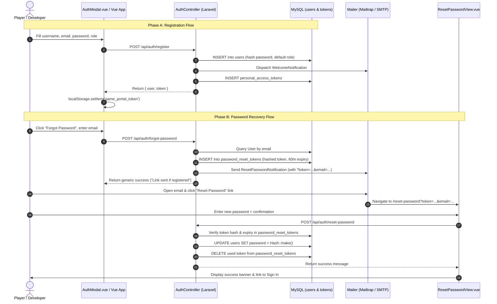
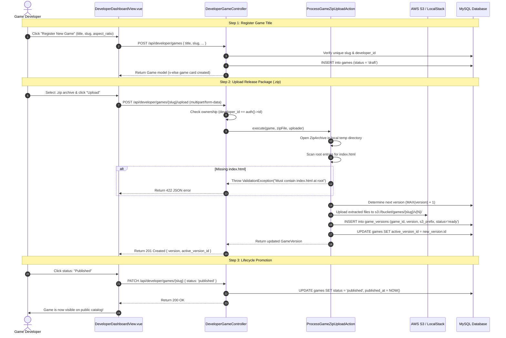
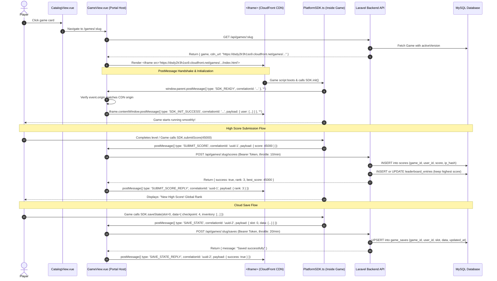
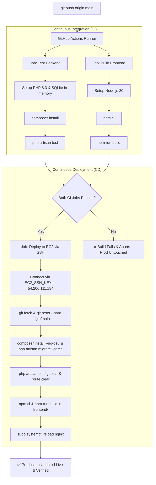

# Arcade Portal — System Architecture & Deep End-to-End Flows

> **Living Technical Specification & Architecture Manual**  
> Covers Platform Architecture, Security Boundaries, Database Design, CI/CD, and End-to-End Request Lifecycles from Frontend to Backend.

---

## 1. High-Level System Architecture

The Arcade Portal is architected around a strict **separation of concerns** between three distinct execution domains:
1. **The Game Sandbox (Untrusted Client)**: HTML5/JS/WASM games running inside a locked-down `<iframe>`, completely isolated from direct database access or authorization tokens.
2. **The Portal Frontend (Trusted Single-Page Application)**: Vue 3 + Pinia + Bootstrap 5 SPA responsible for user session management, catalog browsing, developer dashboard, and the secure postMessage relay bridge.
3. **The Backend & Storage Infrastructure (Authoritative Core)**: Laravel 11 REST API, MySQL 8.0, AWS S3 private storage, and AWS CloudFront CDN.

```
┌────────────────────────────────────────────────────────────────────────────────────────┐
│                                   PLAYER'S BROWSER                                     │
│                                                                                        │
│   ┌────────────────────────────────┐            ┌──────────────────────────────────┐   │
│   │   HTML5 Game Client (Iframe)   │            │     Vue 3 Single Page App        │   │
│   │   - Served from CloudFront CDN │            │     - Catalog, Player, Studio    │   │
│   │   - Runs PlatformSDK.ts        │            │     - Pinia Auth & Session Store │   │
│   │   - Zero secrets / tokens      │            │     - Holds Sanctum Bearer Token │   │
│   └───────────────┬────────────────┘            └─────────────────┬────────────────┘   │
│                   │                                               │                    │
│                   │         window.postMessage (Structured)       │                    │
│                   └───────────────────────────────────────────────┘                    │
└───────────────────────────────────────────┬────────────────────────────────────────────┘
                                            │ HTTPS JSON REST API (/api/*)
                                            ▼
┌────────────────────────────────────────────────────────────────────────────────────────┐
│                             AWS EC2 HOST (Ubuntu 24.04)                                │
│                                                                                        │
│   ┌────────────────────────────────────────────────────────────────────────────────┐   │
│   │   Nginx Reverse Proxy & SSL (Certbot / Port 443 / arcadeportal.duckdns.org)    │   │
│   │   - Serves Vue static bundle (dist/) for non-API routes                        │   │
│   │   - Rewrites /api/* to Laravel PHP-FPM socket                                  │   │
│   └───────────────────────────────────────┬────────────────────────────────────────┘   │
│                                           │                                            │
│                                           ▼                                            │
│   ┌────────────────────────────────────────────────────────────────────────────────┐   │
│   │   Laravel 11 Backend API (PHP 8.3 FPM)                                         │   │
│   │   - FormRequest Validation & Rate Limiters (Throttle middleware)               │   │
│   │   - Action-Domain Architecture (ProcessGameZipUploadAction)                   │   │
│   │   - Laravel Sanctum Token Authentication & RBAC (Player / Developer / Admin)   │   │
│   │   - Mail Notifications (WelcomeNotification, ResetPasswordNotification)        │   │
│   └───────────────────────┬───────────────────────────────┬────────────────────────┘   │
│                           │                               │                            │
│                           ▼                               ▼                            │
│   ┌───────────────────────────────────┐       ┌────────────────────────────────────┐   │
│   │   MySQL 8.0 Database              │       │   Local File / S3 Disk Driver      │   │
│   │   - users, games, game_versions   │       │   - Zip bundle decompression       │   │
│   │   - scores, leaderboard_entries   │       │   - Asset staging                  │   │
│   │   - game_saves, password_resets   │       └────────────────┬───────────────────┘   │
│   └───────────────────────────────────┘                        │                       │
└────────────────────────────────────────────────────────────────┼───────────────────────┘
                                                                 │ PutObject (SigV4)
                                                                 ▼
┌────────────────────────────────────────────────────────────────────────────────────────┐
│                              AWS CLOUD INFRASTRUCTURE                                  │
│                                                                                        │
│   ┌─────────────────────────────────────┐      Signed OAC      ┌───────────────────┐   │
│   │   AWS CloudFront CDN                │ ───────────────────▶ │   AWS S3 Bucket   │   │
│   │   (Edge caching, HTTPS, SigV4 OAC)  │                      │   (100% Private,  │   │
│   │   dsdy2lr3h1so9.cloudfront.net      │                      │   BlockPublic=ON) │   │
│   └─────────────────────────────────────┘                      └───────────────────┘   │
└────────────────────────────────────────────────────────────────────────────────────────┘
```

---

## 2. Core Security Boundaries & Guard Rails

### A. The Two-Party Sandbox & Message Protocol
- **No Token in the Game**: The game client inside the `<iframe>` does not know who the player is, nor does it receive the player's Laravel Sanctum token. This prevents any game script from exfiltrating authentication tokens.
- **Strict Origin Verification**: The parent Vue app only processes messages received from allowed origins (`import.meta.env.VITE_GAME_CDN_ORIGIN` or LocalStack).
- **Correlation ID (UUID)**: Every request emitted by `PlatformSDK.ts` contains a unique `correlationId`. The parent app fulfills the request via the backend API and posts the result back with the matching `correlationId`, allowing asynchronous promise resolution inside the game engine.

### B. Role-Based Access Control (RBAC)
User roles are stored as an enum in MySQL: `player`, `developer`, `admin`.
- **Frontend Route Guard**: Vue Router's `beforeEach` navigation guard checks `to.meta.requiresDev`. If a player without developer permissions attempts to visit `/developer`, navigation is rejected and redirected to the home catalog.
- **Backend API Guard**: Controllers inspect `$request->user()->role`. Even if someone bypasses the client routing, API endpoints like `POST /api/developer/games` return an authoritative `403 Forbidden`.
- **Game Ownership Verification**: When uploading `.zip` files or updating game status, Laravel verifies:
  ```php
  if ($request->user()->id !== $game->developer_id && $request->user()->role !== 'admin') {
      return response()->json(['message' => 'Unauthorized: You do not own this game.'], 403);
  }
  ```

### C. AWS Least-Privilege & Private S3 OAC
- The S3 asset bucket (`game-portal-assets-208588112005`) has **Block Public Access = ON**. Direct anonymous HTTP requests to S3 return `403 AccessDenied`.
- All game files are served exclusively through **AWS CloudFront** using **Origin Access Control (OAC)** with AWS SigV4 request signing.
- Game uploads are strictly isolated into prefix paths: `games/{slug}/v{version}/`.

---

## 3. Deep Request & Data Flows

### Flow 1: Authentication & Password Recovery



---

### Flow 2: Developer Studio Game Lifecycle & Zip Ingestion



---

### Flow 3: Game Execution & Sandboxed SDK Relay

When a player launches a game, the game runs inside an isolated iframe, executing client code that communicates exclusively via postMessage:



---

### Flow 4: High-Performance Leaderboard Architecture

Instead of calculating leaderboards using costly live aggregation (`SELECT user_id, MAX(score) FROM scores GROUP BY user_id`), our schema separates audit logs from fast index scans:

1. **Write Path (`POST /api/games/{slug}/scores`)**:
   - Every single play is appended to the `scores` table (full historical record with SHA-256 IP audit trail).
   - Laravel checks or updates the single record in `leaderboard_entries` for `(game_id, user_id)`:
     - If new score is higher: updates `best_score = new_score` and `achieved_at = NOW()`.
2. **Read Path (`GET /api/games/{slug}/leaderboard`)**:
   - Queries `leaderboard_entries` directly:
     ```sql
     SELECT user_id, best_score, achieved_at 
     FROM leaderboard_entries 
     WHERE game_id = ? 
     ORDER BY best_score DESC, achieved_at ASC 
     LIMIT 50;
     ```
   - **Performance**: Powered entirely by the composite index `lb_rank_idx (game_id, best_score DESC, achieved_at ASC)`—sub-millisecond lookups with zero runtime aggregations.

---

## 4. Production CI/CD Pipeline & EC2 Topology



### Production Host Configuration Summary

| Component | Setting / Location | Purpose |
|---|---|---|
| **Host Operating System** | Ubuntu 24.04 LTS on AWS EC2 (`t3.micro`) | Application server host |
| **Static Elastic IP** | `54.206.111.184` | Fixed IP that never changes upon reboot |
| **Domain & DNS** | `arcadeportal.duckdns.org` | Standard worldwide domain routing |
| **SSL / TLS Certificate** | Let's Encrypt via Certbot (`/etc/letsencrypt/live/...`) | HTTPS port 443 encryption & auto-renew |
| **Web Server (Nginx)** | `/etc/nginx/sites-available/game-portal` | Serves Vue SPA bundle, proxies `/api/*` to PHP-FPM |
| **Backend Runtime** | PHP 8.3 FPM (`/run/php/php8.3-fpm.sock`) | High-performance fastCGI PHP worker pool |
| **Relational Database** | MySQL 8.0 on `localhost:3306` (`game_portal`) | Production database |
| **CDN & Game Storage** | AWS CloudFront (`dsdy2lr3h1so9.cloudfront.net`) + S3 | Global edge caching & zero-latency game loading |

---

## 5. Repository File & Component Directory Map

```
web-platform/
├── backend/
│   ├── app/
│   │   ├── Actions/
│   │   │   └── ProcessGameZipUploadAction.php   # Extracts zip, validates index.html, uploads to S3
│   │   ├── Http/Controllers/Api/
│   │   │   ├── AuthController.php               # Login, register, logout, forgot/reset password
│   │   │   ├── DeveloperGameController.php      # Create game, list my games, upload zip, lifecycle status
│   │   │   ├── GameCatalogController.php        # Public catalog listing and game detail
│   │   │   ├── GameScoreController.php          # Score submission & leaderboard fetching
│   │   │   └── GameSaveController.php           # Cloud save slot storage & retrieval
│   │   ├── Models/
│   │   │   ├── User.php                         # Player/Developer/Admin authenticatable model
│   │   │   ├── Game.php                         # Catalog metadata, activeVersion relation
│   │   │   ├── GameVersion.php                  # Version release records (v1, v2...)
│   │   │   ├── Score.php                        # Chronological score logs
│   │   │   ├── LeaderboardEntry.php             # Deduplicated personal bests
│   │   │   └── GameSave.php                     # Cloud save JSON payload
│   │   └── Notifications/
│   │       ├── WelcomeNotification.php          # Welcome email on account creation
│   │       └── ResetPasswordNotification.php    # Secure reset link email
│   ├── database/migrations/                     # Full relational schema migrations
│   ├── routes/api.php                           # REST API routes and throttle middleware
│   └── tests/Feature/
│       └── DeveloperGameTest.php                # Automated backend feature test suite
├── frontend/
│   ├── src/
│   │   ├── api/
│   │   │   └── client.js                        # Axios instance with Bearer token interceptor
│   │   ├── components/
│   │   │   ├── Navbar.vue                       # Responsive nav, role badge, studio button
│   │   │   └── AuthModal.vue                    # Unified Sign In, Register & Forgot Password modal
│   │   ├── router/index.js                      # Vue routes + beforeEach dev route guard
│   │   ├── stores/
│   │   │   └── auth.js                          # Pinia session store (user, token, role flags)
│   │   └── views/
│   │       ├── CatalogView.vue                  # Public game store catalog
│   │       ├── GameView.vue                     # Game player, aspect ratio container, live leaderboard
│   │       ├── DeveloperDashboardView.vue       # Game registration, zip upload, visibility switcher
│   │       └── ResetPasswordView.vue            # Password update view with token verification
├── sdk/
│   └── src/
│       └── PlatformSDK.ts                       # Game client TypeScript helper (postMessage wrapper)
├── infra/
│   ├── deploy-live-ec2.sh                       # Automation provisioning script for AWS EC2
│   ├── localstack/                              # Local S3 emulation scripts
│   └── terraform/                               # Infrastructure as Code (S3, CloudFront OAC, IAM)
├── .github/workflows/
│   ├── deploy-production.yml                    # Automated CI/CD pipeline (Test ➔ Build ➔ Deploy)
│   └── deploy-test-harness.yml                  # Game asset CI deployment & security boundary test
└── docs/
    ├── SYSTEM_ARCHITECTURE_AND_FLOWS.md         # This comprehensive architectural manual
    ├── AWS_DEPLOYMENT_GUIDE.md                  # Manual & Terraform AWS setup walkthrough
    └── PHASES_SUMMARY.md                        # Phase-by-phase development recap
```
